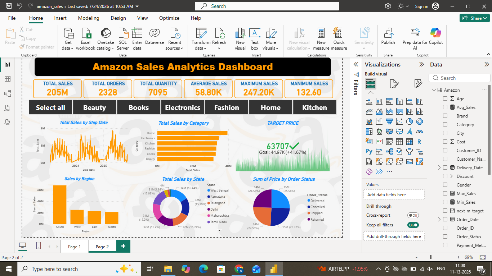

# Amazon Sales Analysis

## Project Overview
This project analyzes Amazon product sales data
using Microsoft Power BI to identify sales trends,
product performance, and business insights.

## Tools & Technologies
- Microsoft Power BI
- Microsoft Excel
- Data Cleaning
- Data Visualization

## Dashboard Preview

## Dashboard Highlights
- Total Sales: 205M
- Total Orders: 2,328
- Total Quantity: 7,095
- Average Sales: 58.80K
- Sales analysis by category, region and state
- Order status analysis

## Dataset
Amazon Products Sales Cleaned Dataset.

## Project Files
- amazon_products_sales_data_cleaned.csv
- amazon_sales.pbix

## Key Features
- Sales performance analysis
- Product analysis
- Interactive Power BI dashboard
- Business insights through data visualization

## How to Use
1. Download the repository.
2. Open amazon_sales.pbix using Power BI Desktop.
3. If required, update the dataset file path.
4. Refresh the data to view the dashboard.

## Author
Sai Sandeep